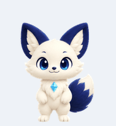
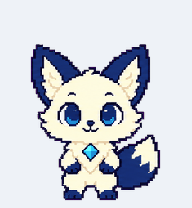

# Woogi · Codex Pet

A custom animated fox pet for the **Codex desktop app**, available in two styles: **Woogi** (3D style) and **Woogi Pixel** (pixel art). Ivory fur, navy ears and tail, and a teal prism.

| Woogi | Woogi Pixel |
| :---: | :---: |
|  |  |

The GIFs show a sample of each pet's animations. The installable assets are transparent PNG sprite sheets, not 3D model files.

## Install in Codex

You need the **Codex desktop app with Pets enabled**. These assets are for its pet companion feature, not a standalone desktop application.

1. [Download this repository as a ZIP](https://github.com/phykn/woogi/archive/refs/heads/main.zip) and extract it, or run `git clone https://github.com/phykn/woogi.git`.
2. Open a terminal in the extracted `woogi-main` folder (or the cloned `woogi` folder). Run the command for your preferred style below, or run both to install both pets.
3. Allow the link to open Codex and confirm the pet installation in the app.
4. Open **Settings → Pets**, select **Woogi** or **Woogi Pixel**, and use `/pet` or **Show pet** to display it. Older app versions may put Pets under **Settings → Appearance**.

**Windows (PowerShell)**

```powershell
powershell -NoProfile -ExecutionPolicy Bypass -File .\install.ps1
# For the pixel version:
powershell -NoProfile -ExecutionPolicy Bypass -File .\install.ps1 -Variant pixel
```

**macOS (Terminal)**

```sh
sh install.sh
# For the pixel version:
sh install.sh pixel
```

The scripts open Codex's official pet installation link with the selected PNG hosted in this repository. They do not change your Codex settings or select a pet automatically. Internet access is required.

If nothing opens, update Codex, launch it once, and check that Pets is available in Settings. An app or account without the pet installation feature cannot use these links. See the official [Pets guide](https://learn.chatgpt.com/docs/pets?surface=app) and [pet installation link reference](https://learn.chatgpt.com/docs/reference/commands#pets).

## Assets & reuse

- [Woogi sprite sheet](pets/woogi/spritesheet.png)
- [Woogi Pixel sprite sheet](pets/woogi-pixel/spritesheet.png)

Both sheets use the **v2 format: 1536 × 2288 px, 8 columns × 11 rows, 192 × 208 px per frame**. Preserve the layout and transparency when editing. To rebuild the preview GIFs, install Python and Pillow, then run `python scripts/preview.py`.

## License

Artwork, previews, and scripts are available under the [MIT License](LICENSE). You may use, modify, and redistribute them, including commercially, while retaining the license notice. This is an independent community project, not an official OpenAI pet.
